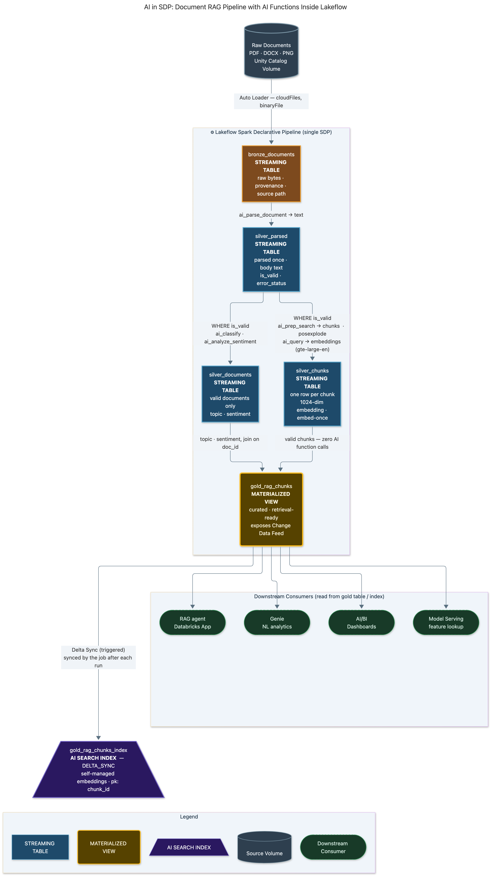

# ai-sdp: document RAG inside one Lakeflow pipeline

A **Lakeflow Spark Declarative Pipeline (SDP)** that turns raw documents (PDF,
DOCX, PNG) into a searchable, governed RAG index, with every AI step running
inline as an AI function. A small RAG agent (`src/agents/rag_agent.py`)
answers questions over the index from the command line.

Built with the `pyspark.pipelines` API on **serverless** compute and deployed
with a Declarative Automation Bundle (formerly Databricks Asset Bundles).



## How it works

**AI Functions in materialized views:** every model call (parse, classify,
sentiment, chunk, embed) runs in a materialized view. On serverless, SDP
refreshes these incrementally: when a new document lands, only its row is
processed (the event log reports `APPEND_ONLY`). Each AI MV sets
`REFRESH POLICY INCREMENTAL STRICT`, so if SDP ever can't refresh one
incrementally, the update **fails** instead of silently re-running every model
call on the whole corpus. Check the technique per MV:

```sql
SELECT timestamp, origin.flow_name, message
FROM event_log(TABLE(<catalog>.<schema>.gold_rag_chunks))
WHERE event_type = 'planning_information'
ORDER BY timestamp DESC;
```

**One query-shape pitfall:** exploding an AI function's output in the same
query, `posexplode(ai_prep_search(parsed))`, can't be refreshed incrementally.
Under the default policy SDP recomputes that MV on every update, even with no
new data. That's why chunking is split: `silver_chunk_prep` stores the
`ai_prep_search` output, and `silver_chunks` explodes the stored column and
embeds.

**Parse once, enrich many times:** `silver_documents` and the chunking MVs read
`silver_parsed` side by side, filtered to valid rows before any model call, and
gold joins topic and sentiment back on `doc_id`. Changing the topic labels makes
the next update fail (STRICT) until you re-classify on purpose with
`--full-refresh silver_documents`, which re-classifies the corpus without
re-parsing or re-embedding anything. Failed parses are never
dropped; list them with:

```sql
SELECT _source_file, error_status, char_count
FROM <catalog>.<schema>.silver_parsed
WHERE NOT is_valid;
```

**Index straight from the MV:** the Delta Sync index sources directly from the
`gold_rag_chunks` MV and syncs the precomputed `embedding` column, so there is
no manual push step. An MV source needs external metadata (also called Smart
Clone) enabled on the MV: `pipelines.externalMetadata.enabled=true` plus
`delta.enableChangeDataFeed=true`, both already set in
`src/pipelines/gold_rag_chunks.py`. External data access for pipeline tables is
in Public Preview.

If your workspace still rejects the MV as a source, there is no table to fall
back to: every table after bronze is a materialized view (see
`docs/reproducibility.md`).

**Sync after every run:** the index is `TRIGGERED`, so the job's second task
(`src/jobs/sync_index.py`) starts a sync once the pipeline finishes and waits
until the index has caught up. New documents are searchable when the job
succeeds.

## Repository layout

```
ai-sdp/
├── databricks.yml                 # Bundle: variables, dev/prod targets
├── example.local.yml.example      # Template for your own (gitignored) targets
├── resources/
│   ├── ai_sdp.pipeline.yml        # Serverless SDP pipeline (PREVIEW channel)
│   ├── ai_sdp.job.yml             # File-arrival job: run pipeline, then sync index
│   └── ai_sdp.vector_search.yml   # AI Search endpoint + Delta Sync index
├── src/
│   ├── pipelines/                 # One file per table
│   │   ├── bronze_documents.py
│   │   ├── silver_parsed.py
│   │   ├── silver_documents.py
│   │   ├── silver_chunk_prep.py
│   │   ├── silver_chunks.py
│   │   └── gold_rag_chunks.py
│   ├── sql_pipeline/              # The same six tables in SQL (not deployed by default)
│   ├── jobs/sync_index.py         # Job task: sync the AI Search index and wait
│   └── agents/rag_agent.py        # RAG agent, usable as a CLI
├── data_generation/
│   ├── generate_documents.py      # 10 base docs + 3 "later" docs (PDF/DOCX/PNG)
│   └── seed.sh                    # schema + volume + upload of the base docs
├── infra/terraform/               # Optional: catalog, schema, volume
├── docs/                          # Architecture diagram (Mermaid source + renders)
├── BUILD.md                       # Design decisions
└── docs/reproducibility.md        # Prerequisites, fallbacks, troubleshooting
```

## Prerequisites

- A Databricks workspace with serverless compute, in a region where
  Foundation Model APIs and AI Functions are available.
- `ai_prep_search` (Beta) enabled for the workspace. Statuses as of
  November 2026: `ai_prep_search` is Beta, `ai_analyze_sentiment` is Public
  Preview, external data access for pipeline tables (needed to index the MV) is
  Public Preview; `ai_parse_document`, `ai_classify` and `ai_query` are GA.
- Databricks Runtime 18.2+ on serverless environment version 3+ for
  `ai_prep_search`, and 17.3 LTS+ for `ai_parse_document`. DBR 18.2 reached end
  of support on 5 Nov 2026, so the pipeline pins the `PREVIEW` channel
  (DBR 19, where it was tested); see the note in `resources/ai_sdp.pipeline.yml`.
- Databricks CLI 1.8 or later (built and tested with v1.17), authenticated:
  ```bash
  databricks auth login --host https://<your-workspace>.cloud.databricks.com --profile <your-profile>
  ```
- Python 3.11+ to generate the sample documents and run the agent CLI:
  ```bash
  python3 -m venv .venv
  .venv/bin/pip install databricks-sdk python-docx fpdf2 Pillow
  ```
- Terraform 1.x, only if you provision the catalog/schema/volume with
  `infra/terraform/`.

## Deploy end to end

The commands below use the `dev` target, which writes to
`ai_sdp_catalog.rag_dev`. If you can't create that catalog, pass
`--var catalog=<your_catalog>` (and `--var schema=...`) to every `bundle`
command, or define your own target in a `*.local.yml` file (see
`example.local.yml.example`).

```bash
P=<your-profile>

# 1. Schema + volume + the 10 base documents (idempotent). The catalog must
#    already exist; create it in the UI, with SQL, or with infra/terraform.
data_generation/seed.sh $P ai_sdp_catalog rag_dev

# 2. Deploy the pipeline, the file-arrival job and the AI Search endpoint + index.
databricks bundle validate --profile $P
databricks bundle deploy   --profile $P

# 3. Run the pipeline once (bronze → silver → gold).
databricks bundle run ai_sdp_rag --profile $P

# 4. Sync the index (TRIGGERED: it reads only what changed in gold). Runs
#    triggered by file arrival do this in the job's sync_index task.
databricks vector-search-indexes sync-index \
  ai_sdp_catalog.rag_dev.gold_rag_chunks_index --profile $P
```

If the first deploy fails with `AI Search endpoint ... not found`, the endpoint
was still provisioning; wait until it is `ONLINE` and run `bundle deploy` again.

**See incremental processing:** upload one file from
`data_generation/generated_docs/later/` to
`/Volumes/ai_sdp_catalog/rag_dev/raw_docs/documents/`. Within about a minute the
file-arrival trigger starts a run in which bronze ingests one row and every
materialized view refreshes incrementally (`APPEND_ONLY`). The job then syncs the index,
and the new document is searchable. To see the refresh technique gold used:

```sql
SELECT timestamp, message
FROM event_log(TABLE(ai_sdp_catalog.rag_dev.gold_rag_chunks))
WHERE event_type = 'planning_information'
ORDER BY timestamp DESC;
```

### Ask the index a question

Query the index with the RAG agent from the command line:

```bash
RAG_INDEX=ai_sdp_catalog.rag_dev.gold_rag_chunks_index \
  .venv/bin/python src/agents/rag_agent.py --profile <your-profile> "How do I reset my password?"
```

## Limitations

- **New documents only.** The file-arrival trigger fires for new files only
  (overwriting a file with the same name does not start a run), and bronze is
  an append-only streaming table, so an edited file isn't re-processed by
  default and a deleted file's chunks stay in the index. Upload a new version
  under a new file name.
- **STRICT means changes are deliberate.** A changed label set, prompt or
  embedding model can't be applied incrementally, so the next update fails
  until you full-refresh that MV. That's intended: it stops a code change from
  silently re-running model calls on the whole corpus. A
  production version would use AUTO CDC keyed on `chunk_id` and remove a
  document's old chunks by `doc_id`.
- **Previews.** `ai_prep_search` is Beta, `ai_analyze_sentiment` and external
  data access for pipeline tables are Public Preview; all may change before GA.
- **Sample corpus.** The generated documents are short and produce one chunk
  each. Test chunk counts, cost and retrieval quality on your own documents.

## License

Apache 2.0, see [LICENSE](LICENSE). Databricks logos and product icons are
trademarks of Databricks, Inc. and are not covered by the license (see [NOTICE](NOTICE)).
